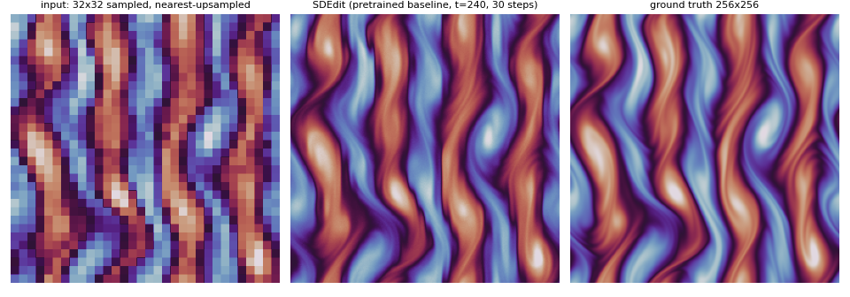
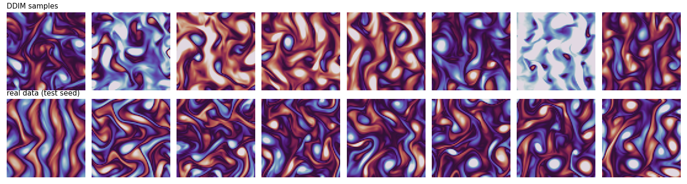
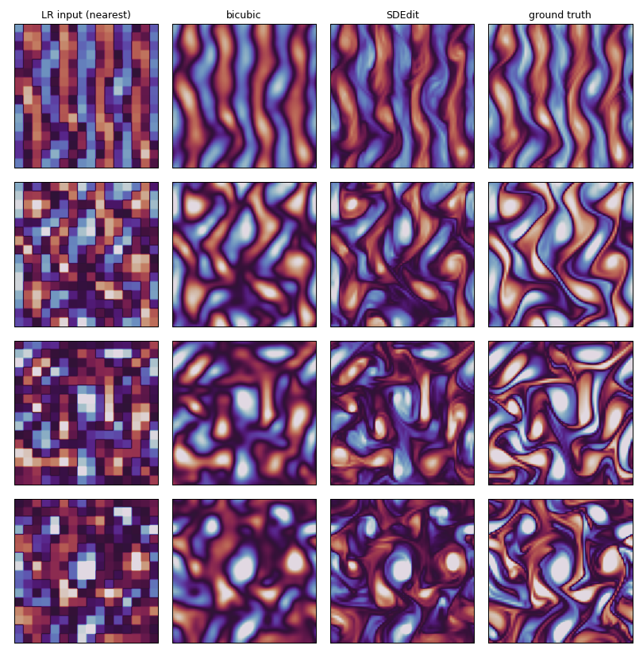
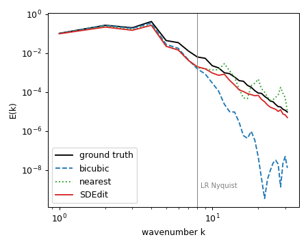

# Reproducing "A Physics-informed Diffusion Model for High-fidelity Flow Field Reconstruction"

CPSC 7430 final project (Option 2), phase 1: getting the authors' code running before writing our own implementation.

Paper: Shu, Li & Barati Farimani, *J. Comput. Phys.* 2023 ([arXiv 2211.14680](https://arxiv.org/abs/2211.14680)).
Original code: [BaratiLab/Diffusion-based-Fluid-Super-resolution](https://github.com/BaratiLab/Diffusion-based-Fluid-Super-resolution) (MIT), included here in `Diffusion-based-Fluid-Super-resolution/`.

**What was done**

1. Ran the authors' pretrained 256×256 model (SDEdit reconstruction from a 32×32 input).
2. Downsampled the Kolmogorov-flow data (Re = 1000) to 64×64.
3. Trained a smaller unconditional DDPM on it (5k steps, laptop RTX 2060).
4. Tested 64 → 16 → 64 reconstruction against bicubic interpolation.

**Where the code changes are**

- Commit 1 imports the original code unchanged.
- [Commit 2](../../commit/b2a57cf0036dd806c61fb79e582a0e7731558dcd) contains every change needed to run it, so its diff shows exactly what was modified.
- [REPRO_LOG.md](REPRO_LOG.md) records each problem, its cause and its fix, with the commands used.

## Findings about the original code

- **It does not run on the stated PyTorch 1.7.** It calls `torch.fft.fft2/irfft2`, which only exist from PyTorch 1.8. Replaced with the equivalent `fftn/irfftn`.
- **Architecture mismatch between training and inference.** The last conv of the unconditional UNet uses circular padding in the training code but zero padding in the inference code. The pretrained checkpoint was trained with circular padding: switching inference to circular cuts the border noise-prediction error about 10× and halves the PDE residual of the reconstruction (71 → 38).
- Smaller bugs:
  - the training entry point was hard-coded to the conditional model;
  - a Python-2 idiom in the dataset crashes after ~125 steps;
  - plotting crashes for batch sizes below 10;
  - `n_iters` in the config is never read.
- **Silent pitfall for short runs:** the EMA has no warm-up. With the default rate 0.9999, 61% of the random initialization is still in the sampling weights after 5k steps.

## Results

### 256×256, authors' pretrained baseline (input: 32×32, every 8th grid point, nearest-upsampled)



| | L2 to ground truth | vorticity residual |
|---|---|---|
| input | 2.209 | 2071 |
| SDEdit (t = 240, 30 DDIM steps) | **1.900** | **37.8** |
| ground truth | 0 | 0.172 |

The official low-res input file could not be downloaded (figshare blocks command-line downloads), so we built a stand-in with a regular grid. The paper's file samples random grid points.

### 64×64, our model trained for 5k steps

**Unconditional samples** (DDIM, 100 steps from pure noise; top row samples, bottom row real data):



**64 → 16 → 64 reconstruction**, 100 test frames. The 16×16 input is a 4×4 average pool; SDEdit starts from its nearest-upsampled version.

| method | RMSE | relative L2 |
|---|---|---|
| nearest (SDEdit input) | 2.94 | 0.538 |
| bicubic (periodic) | **2.08** | **0.380** |
| SDEdit, t = 240 | 2.56 | 0.467 |
| SDEdit, t = 320 | 2.55 | 0.465 |

 

SDEdit improves on its input but has a higher pointwise error than bicubic. However, it reproduces the ground-truth energy spectrum beyond the low-res Nyquist wavenumber, where bicubic's energy falls by orders of magnitude.

A 16×16 input does not fix *where* the small vortices are, and a pointwise metric penalizes realistic detail in slightly wrong places twice: once where it is missing and once where it was placed. This setting is also much harder than the paper's (8× from 32×32), and our model had only 5k steps and no physics conditioning.

## Reproducing

```bash
conda create -n pidm python=3.8 pip -c conda-forge --override-channels -y && conda activate pidm
pip install torch==1.7.1+cu101 torchvision==0.8.2+cu101 -f https://download.pytorch.org/whl/torch_stable.html
pip install -r requirements.txt
```

Data goes in `data/`; it is not in git. It needs:

- the high-res data `kf_2d_re1000_256_40seed.npy` ([figshare](https://figshare.com/ndownloader/files/39181919));
- the authors' pretrained weights ([baseline](https://figshare.com/ndownloader/files/40320733), [conditional](https://figshare.com/ndownloader/files/39184073)), placed in `Diffusion-based-Fluid-Super-resolution/pretrained_weights/`.

```bash
python scripts/make_lowres_input.py data/kf_2d_re1000_256_40seed.npy data/kmflow_lowres_u32.npz --factor 8
python scripts/downsample_kf.py data/kf_2d_re1000_256_40seed.npy data/kf_2d_re1000_64_40seed.npy --factor 4
python scripts/make_lowres_input.py data/kf_2d_re1000_64_40seed.npy data/kmflow_lowres_u16_from64.npz --factor 4 --down avg

cd Diffusion-based-Fluid-Super-resolution
python main.py --config kmflow_re1000_rs256_sparse_recons_local.yml --t 240 --r 30 --max_batches 1     # 256, pretrained
(cd train_ddpm && python main.py --config km_re1000_rs64.yml --exp ./experiments/km64_baseline/ --doc km64_baseline --ni)
python main.py --config kmflow_re1000_rs64_sparse_recons_local.yml --t 320 --r 30 --max_batches 5      # 64, ours
python ../scripts/compare_recons.py experiments/kmflow_re1000_rs64_local/recons_u1616_nearest_t320_r30_lam0.0 --factor 4
```

## Next steps

- Repeated SDEdit (`sample_step` > 1).
- The physics-conditioned model (the paper's main method) at 64×64.
- Longer training.
- Then our own implementation.
